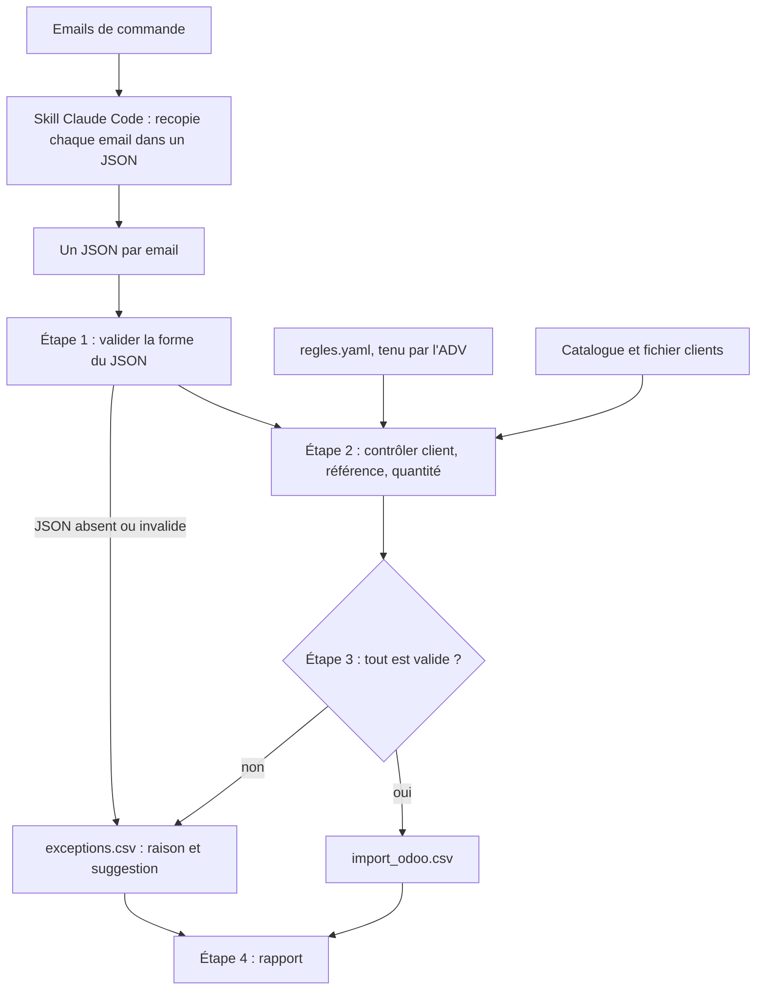

# Des commandes reçues par email à l'import Odoo

Une marque de cosmétiques vendue en pharmacie reçoit ses commandes par email,
dans des formats variés. Une personne de l'ADV (administration des ventes) les
ressaisit dans l'ERP, Odoo. Ce prototype lit les emails, contrôle ce qu'il a lu,
prépare un fichier d'import pour ce qui est sûr, et confie le reste à un humain
avec la raison.

Tout est fictif : la marque, les produits, les pharmacies et les emails.

## 1. Avant / après

**Avant : un email flou** (`data/inbox/02_centre_texte_flou.txt`)

```
Bonjour,

il nous faudrait pour la semaine prochaine :
2 cartons du déo
la crème mains, 12 comme d'habitude
et 6 gels douche

Merci d'avance
Pharmacie du Centre
```

**Après : rien n'est deviné.** Cet email ne produit aucune ligne d'import. La
commande part en entier chez un humain, dans `sorties/exceptions.csv`, avec la
raison de chaque blocage. Extrait :

| Ligne | Raison | Suggestion |
|---|---|---|
| Commande entière | 2 pharmacies s'appellent « Pharmacie du Centre » (Valbrune-sur-Orve, Montclar-le-Lac) et l'email ne donne ni code client ni code postal. | C1001 ou C1002 |
| 2 cartons du déo | L'email ne donne aucun code produit (ni code-barres, ni référence). | VB-105 Déodorant bille douceur 50 ml ; VB-106 Déodorant spray fraîcheur 100 ml |
| 2 cartons du déo | La quantité est donnée en « cartons » : le nombre d'unités n'est pas écrit dans l'email. | |

**Après : ce qui est sûr passe sans ressaisie.** Dans un autre email, la ligne
`12 x Crème mains réparatrice 75 ml (EAN 2055501001023)`, envoyée par un client
identifié, devient cette ligne de `sorties/import_odoo.csv` :

```
partner_id/id,client_order_ref,date_order,order_line/product_id,order_line/product_uom_qty,order_line/price_unit
client_C1003,CDE-TIL-2311,2026-11-03 09:12:00,VB-102,12,4.20
```

**Les 5 emails de démonstration**

| Email | Format | Résultat | Pourquoi |
|---|---|---|---|
| 01 | Texte libre, avec code client et EAN | Import Odoo, 3 lignes | Tout est vérifié |
| 02 | Texte libre, sans aucun code | Exceptions | Client homonyme, produits sans code, quantité en cartons |
| 03 | Tableau HTML | Exceptions | 10 unités commandées pour un colisage de 6 |
| 04 | Tableau en texte | Exceptions | Un EAN avec une faute de frappe, une quantité de 120 au-dessus du plafond |
| 05 | Bon de commande PDF en pièce jointe | Import Odoo, 4 lignes | Tout est vérifié |

Sur ces 5 emails, 2 commandes et 7 lignes sur 17 passent sans intervention. Ces
emails ont été écrits pour la démonstration : ces chiffres montrent le
fonctionnement, pas une performance.

## 2. Comprendre

Je n'ai pas observé cette équipe ADV. Voici mes hypothèses sur son
fonctionnement et ce que le prototype en fait.

| Sujet | Mon hypothèse | Choix du prototype |
|---|---|---|
| Identification de la pharmacie | Le code client n'est presque jamais écrit. L'ADV reconnaît la pharmacie à l'expéditeur, à la signature ou à l'habitude | Code client, ou nom et code postal, sinon exception. L'expéditeur n'est pas utilisé, volontairement |
| Quantité hors colisage | Les produits se vendent par colis complets. L'ADV n'arrondit jamais sans l'accord de la pharmacie | Refus, avec les deux multiples voisins proposés |
| Remises et prix négociés | Le prix vient du tarif et des conditions négociées. Un agent ne doit jamais lire un prix dans un email | Prix du catalogue uniquement, remises hors périmètre |
| Ruptures | Celui qui lit l'email ne connaît pas le stock. L'ADV arbitre selon le client et le minimum de commande | Stock non regardé : l'ERP gère la disponibilité après l'import |
| Doublons et relances | Ils viennent des relances, des copies à un commercial et des bons renvoyés corrigés. L'ADV les repère de mémoire | Non traité. Prochaine étape : un contrôle « commande déjà vue » qui envoie en exception, sans jamais supprimer seul |
| Commandes transmises par un commercial | L'expéditeur n'est pas le client, le format change, des conditions ont pu être accordées à l'oral | Client identifié par le contenu de l'email, jamais par l'expéditeur |

Le détail de chaque hypothèse, et les questions que je poserais à l'équipe en
immersion : [`docs/hypotheses_adv.md`](docs/hypotheses_adv.md).

## 3. Prioriser

**Périmètre : les commandes directes reçues par email.** Les commandes qui
passent par un grossiste n'en font pas partie.

Pourquoi ce périmètre :
- La ressaisie est répétitive, et ses erreurs se paient à la livraison : mauvais
  client, mauvais produit, mauvaise quantité. Les trois contrôles du prototype
  portent sur ces trois points.
- Une commande fausse dans l'ERP coûte plus cher qu'une commande traitée à la
  main. J'ai donc préféré un outil qui laisse passer peu de commandes mais ne se
  trompe pas, à un outil qui en traite beaucoup en devinant.

Ce que j'ai volontairement laissé de côté :

| Sujet | Pourquoi |
|---|---|
| Remises et prix négociés | Le prix reste celui de l'ERP, jamais celui d'un email |
| Stock et ruptures | L'ERP gère la disponibilité après l'import |
| Doublons et relances | Prochaine étape, une fois la fréquence réelle connue |
| Adresse de l'expéditeur | Peu fiable tant que les boîtes partagées et les groupements ne sont pas compris |
| Commandes par grossiste | Autre circuit, autres règles |
| Lecture de la boîte mail et écriture directe dans Odoo | Un fichier d'import laisse la main à l'ADV pendant la phase de test |
| Correction automatique | Exclue par principe : le script propose, un humain décide |

## 4. Construire



**Le principe : le LLM lit, le code décide.** Le LLM recopie ce qui est écrit
dans l'email vers un JSON structuré. Il ne corrige rien, ne devine rien, ne
choisit pas une référence. Ces interdits sont écrits dans
[le skill](.claude/skills/traiter-commandes/SKILL.md). Tous les contrôles et
toutes les décisions sont du Python déterministe et testé : les mêmes données
donnent toujours le même résultat.

Trois conséquences :
- Une commande n'est jamais coupée en deux : elle va en entier à l'import, ou en
  entier chez un humain.
- Aucun email n'est perdu. Un JSON absent ou abîmé, un PDF vide : la commande
  part en exception « extraction illisible ».
- Les règles métier (plafond de quantité, colisage, seuil de ressemblance) sont
  dans [`regles.yaml`](regles.yaml), que l'ADV modifie sans toucher au code.

**Lancer le projet**

```bash
pip install -r requirements.txt
python -m src.main
python -m pytest
```

`python -m src.main` relit les JSON de `data/extractions/` et réécrit les trois
fichiers de `sorties/`. `python -m pytest` lance les 75 tests : chaque contrôle
(cas passants et cas en échec), la clé EAN, l'écriture du CSV Odoo, et un test
de bout en bout comparé aux résultats attendus de `data/attendu/`.

Pour refaire l'extraction elle-même, il faut Claude Code : ouvrir le dépôt et
taper `/traiter-commandes`.

**D'où viennent les extractions.** Les JSON de `data/extractions/` viennent
d'une vraie exécution du skill dans Claude Code, le 12 novembre 2026. Ils n'ont
pas été écrits à la main. Ils sont commités pour que les tests, et un lecteur
sans Claude Code, puissent tout relancer.

**Deux exécutions comparées.** Le skill a été lancé deux fois sur les 5 emails :
- une première fois dans la session de travail où le projet a été construit ;
- une seconde fois dans une session neuve, qui ne connaissait pas le projet et
  n'avait pas vu les résultats attendus de `data/attendu/`.

Le skill interdit de lire les extractions déjà présentes dans le dépôt.
Résultat : les 5 JSON de la seconde exécution sont identiques octet pour octet
à ceux de la première. C'est un constat sur 5 emails et 2 exécutions, pas une
preuve de stabilité à grande échelle.

**Format Odoo.** Le fichier suit le format d'import natif des commandes avec
leurs lignes, vérifié dans la documentation Odoo. Les colonnes se règlent dans
[`odoo_colonnes.yaml`](odoo_colonnes.yaml). La marche à suivre pour le tester
est dans [`docs/test_odoo.md`](docs/test_odoo.md).

> **À COMPLÉTER : résultat du test dans une base Odoo.** L'import des clients,
> des produits puis des commandes dans une base Odoo Online reste à faire.
> Résultat et capture d'écran à venir.

**Où regarder**

| Dossier | Contenu |
|---|---|
| `data/inbox/` | Les 5 emails |
| `data/extractions/` | Ce que le skill a recopié |
| `data/attendu/` | Les résultats attendus, écrits avant le code |
| `src/` | Un module par étape : `valider`, `controler`, `router`, `rapport` |
| `tests/` | Les tests |
| `sorties/` | L'import Odoo, les exceptions, le rapport |

## 5. Transférer

[`docs/guide_adv.md`](docs/guide_adv.md) : une page pour l'équipe ADV. Elle
explique comment lire le fichier des exceptions, quoi faire selon le problème,
et comment modifier une règle dans `regles.yaml`.

L'ADV maîtrise ses règles, la technique maintient le code.

## 6. Mesurer

Ce prototype ne mesure rien de réel. En conditions réelles, je suivrais :

- **La part des commandes et des lignes passées sans intervention.** Elle est
  déjà calculée dans `sorties/rapport.md`.
- **Les commandes importées puis corrigées dans Odoo.** C'est l'indicateur que
  je regarderais en premier : une erreur passée sans être vue.
- **Les exceptions par motif.** Pour savoir quelle règle ou quel format d'email
  travailler d'abord.
- **Les exceptions que l'ADV juge injustifiées.** Trop de prudence fait perdre
  le temps gagné.
- **Le temps passé par commande, avant et après.** Mesuré sur place avec
  l'équipe, pas estimé.
- **La stabilité de l'extraction.** Le même email extrait deux fois doit donner
  le même JSON.

## 7. Limites

- **Pas d'appel d'API.** L'extraction est lancée à la main dans Claude Code. En
  production, on la brancherait sur l'API, ou sur un déclencheur à l'arrivée
  d'un email.
- **Cinq emails fictifs.** Ils ont été écrits pour la démonstration. De vrais
  emails seront plus variés. Les photos et les scans n'ont pas été testés.
- **Des emails simplifiés.** Ce sont des fichiers texte ou HTML, pas de vrais
  fichiers de messagerie avec pièces jointes encodées.
- **Le code client n'est pas recoupé avec le nom.** Un code valide mais mal tapé
  désignerait une autre pharmacie sans alerte.
- **Hors périmètre** (voir [mes hypothèses](docs/hypotheses_adv.md)) : l'adresse de l'expéditeur, les
  remises et prix négociés, le stock et les ruptures, les doublons et relances,
  les commandes passées par un grossiste.
- **L'import Odoo se fait par fichier, à la main.** Il suppose que les clients
  et les produits existent déjà dans Odoo avec les mêmes identifiants.

## 8. En une ligne

Construit avec Claude Code, relu, testé et compris par moi.
